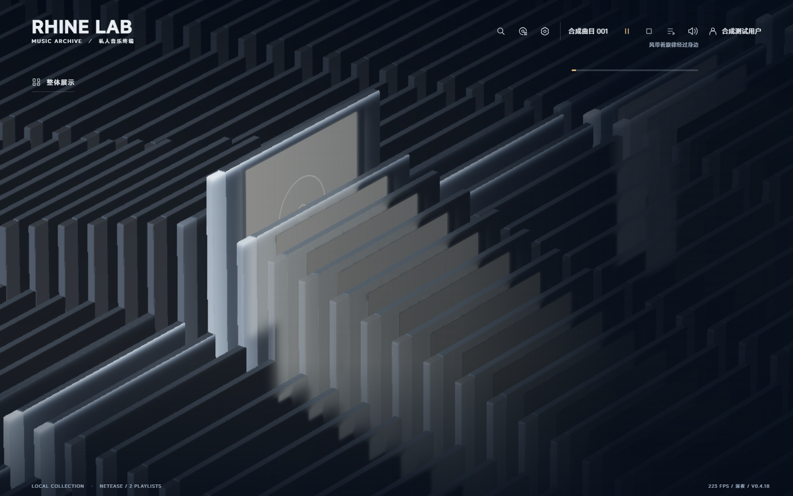
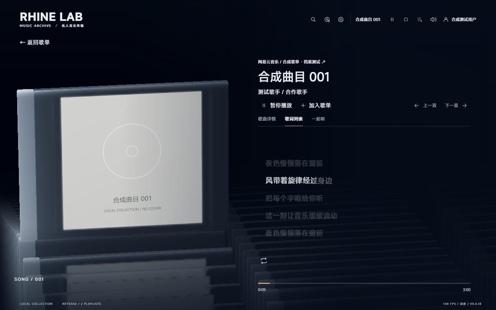
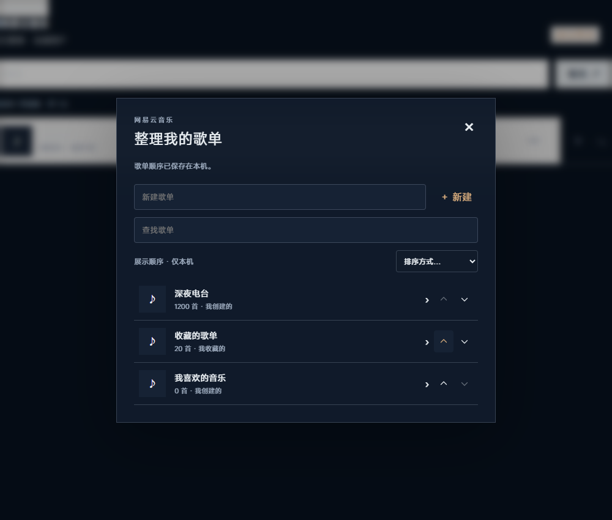

# Rhine Music

用三维唱片架浏览音乐，听歌时看同步歌词。

[下载安装](https://github.com/Raveniume/Rhine-Music/releases/latest) · [使用说明](README.windows.md) · [更新记录](CHANGELOG.md) · [反馈问题](https://github.com/Raveniume/Rhine-Music/issues)



## 功能

- 浏览本地音乐，或登录网易云、QQ 音乐、波点音乐查看曲库和歌单。
- 搜索歌曲、管理播放队列，使用顺序、随机或单曲循环。
- 整理歌单：手动上移、下移，也可按名称或歌曲数量排序；唱片架同步采用这个顺序。
- 歌曲详情显示同步歌词。网易云优先读取逐字时间轴；没有逐字数据时显示逐行歌词。点击歌词可定位播放进度。
- Windows 任务栏歌词、托盘播放控制，以及顶部歌词快捷开关。
- 深浅主题、跟随系统、开场动画、频谱样式、画质和帧率设置。





截图使用合成曲目和示例歌词，不包含私人歌单或歌曲封面。

## 下载和更新

Windows 10 / 11 x64 请下载 Release 中的 `Rhine-Music-Windows-…-x64-Setup.exe`。安装包包含运行环境，无需另装 Node.js 或 Rust。播放器正在运行时，安装器会询问是否关闭后继续；账号、音乐和设置保留。

软件内更新入口为 **设置 → 关于 → 检查更新**。也可以下载新安装包覆盖安装。GitHub 的 Source code 压缩包是源码，不能直接运行。Windows EXE 尚未签名。

macOS 包及其签名、验收状态以对应 Release 说明为准；维护流程见 [macOS 发布说明](docs/MACOS-RELEASE.md)。

安装包不含 FFmpeg／ffprobe 和云信原生聊天 SDK，目前不提供“一起听”。需要额外解码时，可自行安装 FFmpeg 并加入 PATH。在线曲库和播放权限由音乐平台及账号决定。

## 数据与反馈

本地音乐文件和标签只读。登录会话在 Windows 上使用当前用户的 DPAPI 加密。歌单重命名、新建、增删歌曲会提交到当前音乐平台；展示排序不会改动云端歌单。

问题和权利说明通过 [GitHub Issues](https://github.com/Raveniume/Rhine-Music/issues) 提交，请勿附带 Cookie、令牌或私人曲库数据。详见 [隐私说明](PRIVACY.md) 和 [平台说明](PLATFORM-NOTICE.md)。

## 开发

需要 Node.js ≥ 22.12.0。Windows 桌面构建还需要 Rust、Visual Studio C++ 构建工具和 Windows SDK。

```powershell
npm ci
npm run build
$env:VITE_PUBLIC_RELEASE = '1'
npm run desktop:build
```

[安装器构建](docs/WINDOWS-INSTALLER.md) · [验证记录](docs/WINDOWS-VALIDATION.md)

## 来源与许可

本项目基于 [RonaldDeng/Rhine-Music-Demo](https://github.com/RonaldDeng/Rhine-Music-Demo) V0.4.1，由 [Raveniume](https://github.com/Raveniume/Rhine-Music) 维护；视觉与渲染基础来自 [LBEILC/RhineLabUI](https://github.com/LBEILC/RhineLabUI)，逐字歌词使用 [AMLL](https://github.com/amll-dev/applemusic-like-lyrics)。本项目与音乐平台及原作品牌方没有官方合作关系。

组合工程采用 [AGPL-3.0-only](LICENSE-AGPL-3.0-only)。上游以 MIT 授权的部分保留 [MIT License](LICENSE) 及原作者署名。图片、字体、声音、模型、品牌和音乐内容适用各自许可，详见 [NOTICE](NOTICE.md) 与 [第三方声明](docs/third-party-notices.md)。[原项目说明](README.upstream.md) 保留供查阅。
